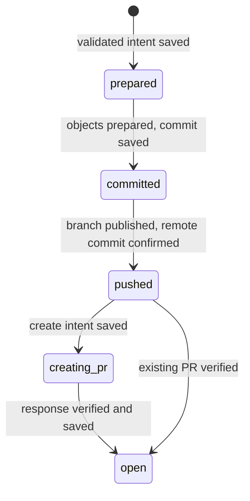

# Source contribution execution

`fx source push` contributes selected source files to a verified personal fork and opens a
PR against its upstream. CodeHost exposes createPullRequest for contributions;
release receives only the `CodeHostQueries` projection, and the repository-sync Git
port has no contribution operations. Contribution Git and transport have separate,
narrow responsibilities.

## Planning and source isolation

Planning reads the registered source's remote settings and asks Git for the
upstream default branch and commit. Provider configuration comes from that
committed base, so an unrelated broken working copy of workspace.yaml cannot
change routing or prevent candidate inspection. If the base is missing locally,
a preview reports needs-fetch and validated=false. Actual execution gates and
locks a source-only fetch, then rebuilds the full plan before asking for push
confirmation.

The candidate is the captured base overlaid with selected whole files. Schema,
lint and boundary checks inspect that candidate. Both text and expanded filenames
are checked; protected filenames are replaced with positional placeholders in
failed previews. Private manifest addresses are allowed, while credentials and
protected personnel content are rejected.

Prompts run outside leases. Registry identity and unfinished lifecycle journals are
checked read-only before planning, including dry-run. After the write gate and any
required confirmation, application acquires operation, workspace and source leases
in that order and rechecks the captured registry/source identity. It then re-reads
the journal, routing, candidate and remote state to validate the locked plan. Changed evidence
rejects the old plan. Automatic lifecycle synchronization uses the same workspace
lease, so it skips while a contribution owns the source.

The expected personal owner comes from the existing explicit `user` setting
(flag/environment/config resolution), or the companion's current-user query
when unset. Configuration identifies the intended namespace; it is not evidence
of authentication. Backend repository identity must still prove personal
ownership, parentage and clone URLs. The plan and confirmation name both source
and target repositories. Native Git and companion permissions remain required.
This supports companions whose Data Center current-user response has no actor.

The `bitbucket-cli` and `github` code hosts implement the contribution calls;
`local-git` does not. `github` drives `gh api`: a personal owner is a GitHub user,
never an organization, and a fork whose parent GitHub does not name is unverified
rather than parentless. GitHub matches repository paths without regard to case, so
the identity also advertises the clone URLs in the spelling the remote uses. A pull
request's title and description reach `gh` through a private temporary file, never
the command line.

## Journal and recovery

Preparing Git objects does not move a branch. The expected commit is recorded
before compare-and-swap publishes the local ref. Publication is idempotent for
that exact commit and refuses a checked-out branch. A push names one commit and
one managed branch, follows no tags, and never uses force.

A lost push response leaves the committed phase. Recovery compares the remote
head with the intended commit and the prior head; it skips an already completed
push and rejects an unrelated advance. A lost create response leaves creating_pr.
It never automatically creates again: the person supplies a known PR ID with
--pr, and repository/branch/target identity is checked before association. A
merged PR can be associated and retired even after its source branch disappears.

Open operations are reused only when the new file set covers every previous
file. Identical trees and confirmed remote commits skip publication. Explicit
closure or absence of an already-pushed branch retires a record; network errors
preserve it. --new retains earlier operations and allocates another branch.

The journal is owned metadata under FX_HOME, protected by a separate write lease
and atomic, synced replacement. It records object identities, selected paths,
phases and PR references, never source bodies, PR descriptions or credentials.
Malformed/foreign files and symlinks are refused. Exported profiles omit it.

## Verification scope

Decision tests inject failures at journal and remote boundaries. Real temporary
Git tests cover object/ref separation, unchanged source HEAD/index/files, exact
bytes and tree hashes. A native workflow test uses the real Git and journal
adapters with a fake code host, including a broken unselected working manifest.
The companion wire contract can be exercised with the
[loopback probe](../eval/README.md#other-reusable-probes).

The source push CLI is wired with variadic source-relative paths, structured
non-interactive input errors, and explicit confirmation. Dry-run suppresses fx
update probes so it does not create update-cache files. Known PR URLs are resolved
by the provider against the current repository website before an ID query; the
supplied URL is never used as an arbitrary request destination.

Probe recording is described in [its execution contract](probe-recording.md).
The contribution e2e matrix covers recovery through the built CLI.
Automated acceptance and native limitations are recorded in the validation guidance.

The identity guard retains the registered logical source path alongside the captured
physical source and workspace root. It re-resolves the logical source/root under the
operation lease and reads pending lifecycle state through the current logical path.
Retargeting a symlink ancestor therefore cannot pair Git operations on the old source
with configuration or journals under a different personal home.
